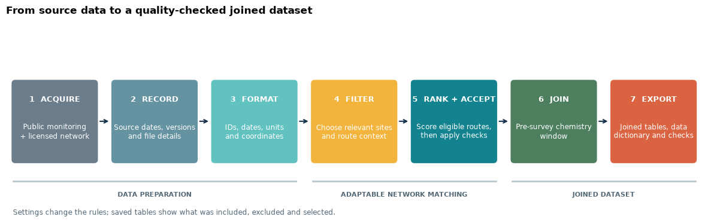
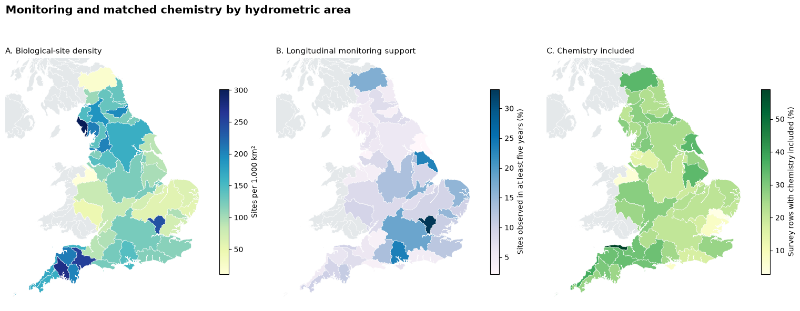
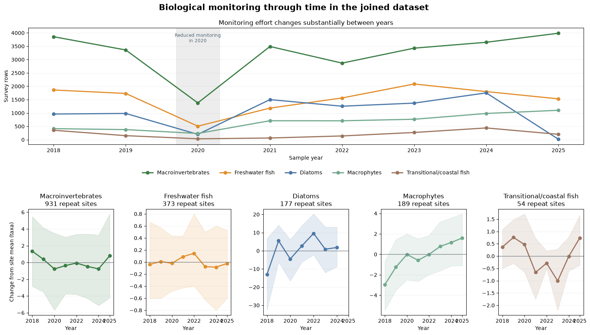

# The Connected River

This repository shows how I built a joined river-monitoring dataset from data
collected at different places and times. It covers downloading and formatting
the source data, matching sites through the river network, joining chemistry to
biological surveys and checking the result.

The two notebooks are intended to be read in order:

- [`The_Connected_River_Part_1_Building.ipynb`](The_Connected_River_Part_1_Building.ipynb),
  **The Connected River (Part 1) - Building**, explains and runs the reusable
  matching method.
- [`The_Connected_River_Part_2_Exploring.ipynb`](The_Connected_River_Part_2_Exploring.ipynb),
  **The Connected River (Part 2) - Exploring**, uses the joined data for maps,
  figures and long-term analysis.

The longer functions are kept in `connected_river/` so that the notebooks remain
readable. The England-wide example is the demonstration, while the adaptable
matching recipe is the main output.



*The workflow keeps data preparation, network matching and the final join as
separate, checkable stages. The filter, ranking and acceptance rules can be
changed for a different monitoring question.*

## Repository contents

```text
The_Connected_River_Part_1_Building.ipynb   data preparation and matching
The_Connected_River_Part_2_Exploring.ipynb  maps, analysis and long-term change
connected_river/                            supporting Python functions
config/                                     source list and default settings
output/                                     notebook PDFs and matching notes
tests/                                      optional checks for the main rules
environment.yml                            environment setup
requirements-release.lock                 exact release environment used here
THIRD_PARTY_DATA.md                         source and licence notes
```

The repository does not include a finished national dataset or the licensed
river network. These are created or supplied by the person running the method.

## Set up the environment

From the repository folder:

```bash
conda env create -f environment.yml
conda activate connected-river
jupyter lab
```

The notebook imports the adjacent `connected_river/` folder directly, so it
does not need to be installed as a package. Start Jupyter from this repository
folder. `requirements-release.lock` records the exact package versions used for
the checked release; `environment.yml` is the easier starting point on another
computer.

## Data needed

Most observations are downloaded by the workflow and saved in the local
workspace. Two UKCEH spatial datasets must be obtained separately under their
own licence terms:

- [UKCEH river-network access and licensing](https://www.ceh.ac.uk/data/15000-watercourse-network)
- [Hydrometric Areas with Coastline](https://catalogue.ceh.ac.uk/documents/1957166d-7523-44f4-b279-aa5314163237)

The Connected River (Part 1) - Building needs the topology-enabled UKCEH
river-network CSV used by this workflow, including link and node identifiers.
Request it through UKCEH's data licensing route rather than using a line-only
map layer.

Set `NETWORK_INPUT` and `HYDROLOGICAL_AREAS_INPUT` under **Settings for most
runs** in Part 1. See `THIRD_PARTY_DATA.md` for the source and licence notes.

## Run the method

Open The Connected River (Part 1) - Building, edit **Settings for most runs**,
then choose **Restart Kernel and Run All**. The **Advanced matching settings**
can stay unchanged for the default England-wide example.

`build_england` downloads the public sources, formats them, traces possible
river-network connections, applies the matching recipe and writes the joined
tables. The example begins in 2018. A first national run can take several hours,
but downloads and completed stages are saved in `connected_river_workspace/`
and can be reused.

To inspect an existing result without rebuilding it, use:

```python
RUN_MODE = "use_existing"
EXISTING_RELEASE_DIRECTORY = "/path/to/a/completed/output/folder"
```

Once Part 1 has completed, run The Connected River (Part 2) - Exploring. It
normally finds the latest output in the same workspace. Set `BCR_RELEASE_DIR`
only if that output folder has been moved. The final section can download the
open ChemPop version 2 archive and follow its historical macroinvertebrate sites
into the newer data.

The published ChemPop study provided the starting point for the temporal
summary and site-matching problem. It is discussed as the inspiration for this
workflow rather than included in the main joined dataset.

## Adapt the matching recipe

The recipe has three stages: filter possible routes, rank them with a 100-point
score and check whether the best available route can be accepted. The default
score gives 35 points to river-network distance, 15 to network snapping, 20 to temporal
support, 20 to chemistry support and 10 to flow or river-size evidence.

Part 1 shows how to:

- filter chemistry sites, for example to sites measuring metals;
- keep only upstream or downstream connections;
- use route information such as sewage outlets;
- change the chemistry window from six to twelve months;
- change distance, sample and snapping limits;
- supply a different directed river network; and
- change the ranking weights while keeping a 100-point total.

All possible routes are retained with their score and the reason they were
accepted, rejected or kept for review.

## Main outputs

Generated files are written to the configured workspace. They include:

- a compact analysis-ready CSV;
- a full joined Parquet table;
- all ranked routes and the selected matches;
- a readable summary of the filter and matching choices;
- a data dictionary; and
- source information and output checks.

Part 2 creates a zoomable monitoring map, response curves, a national
1965–2025 macroinvertebrate series, catchment trajectories and paired-site
change summaries by hydrometric area. These figures describe the monitoring
record and do not assign a cause to the observed changes.



*Monitoring density, repeat sampling and usable chemistry coverage vary across
England. Showing them separately makes it clearer where the joined data can
support further analysis.*



*The joined dataset brings together several biological groups. The upper panel
shows annual survey effort; the lower panels summarise change at repeatedly
monitored sites rather than treating changing coverage as a biological trend.*

## Optional checks

The main matching rules can be checked from the repository folder:

```bash
python -m pytest
```

## Limits

A connected pair of sites does not prove that the water was identical at both
locations or that chemistry caused a biological response. Results still depend
on the river-network data, monitoring coverage, coordinates, tributaries and
flow conditions. Routes kept for review should be inspected before using them
for important decisions.

## Funding

This work was carried out as part of the UK Environmental Exposure Hub (EEx
Hub), developed through the UKCEH National Capability for UK Challenges
(NC-UK) programme and funded by NERC (NE/Y006208/1).
